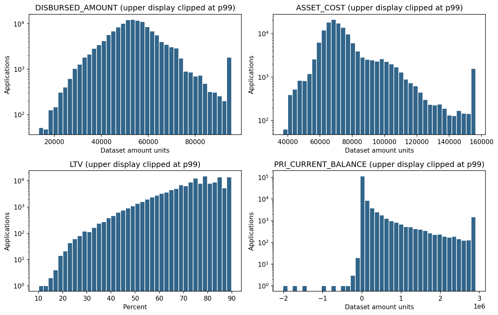
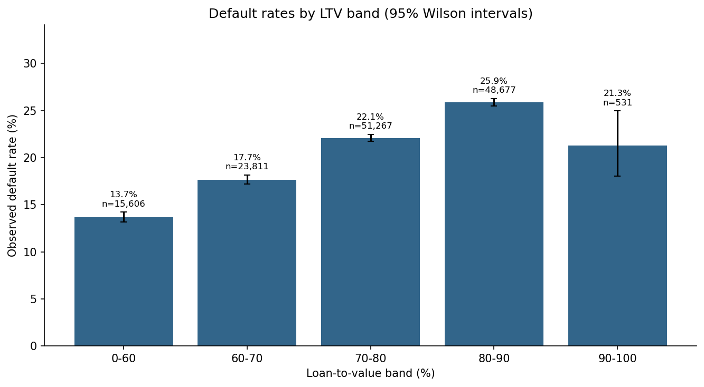
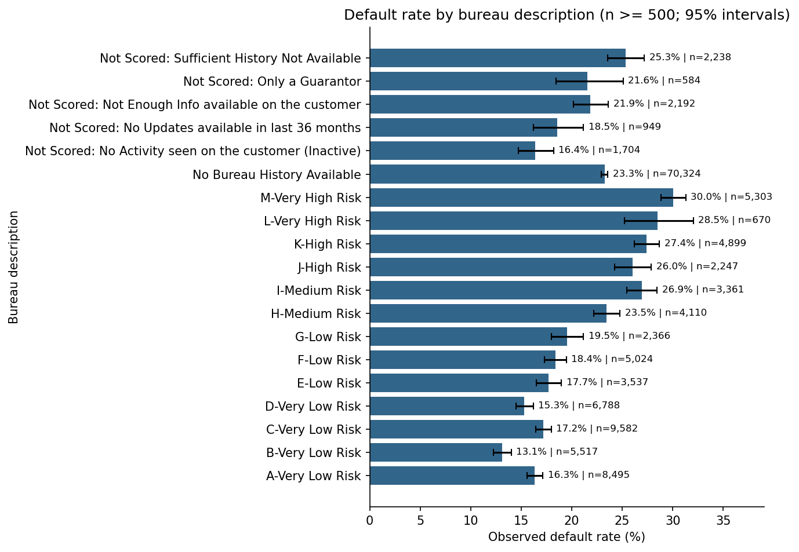
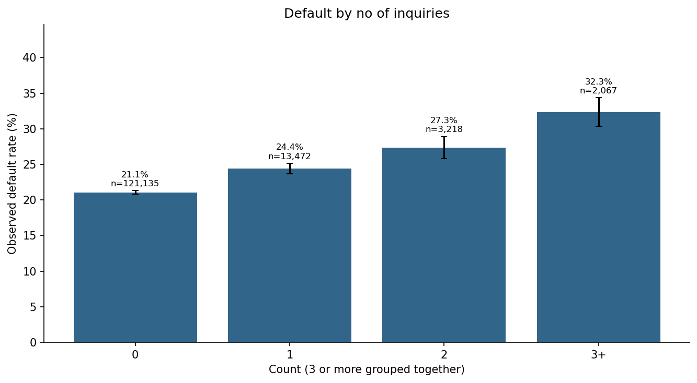
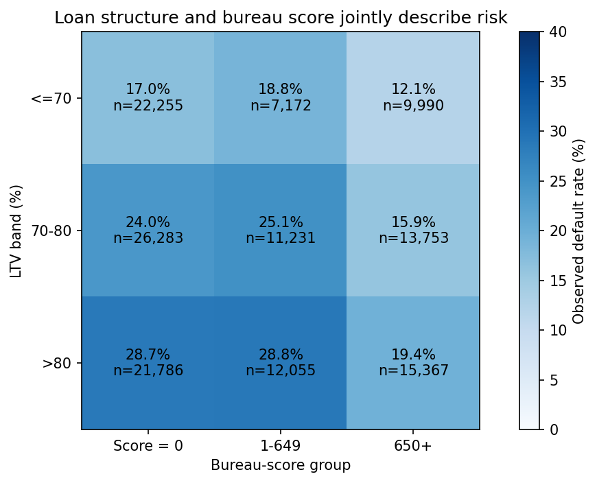
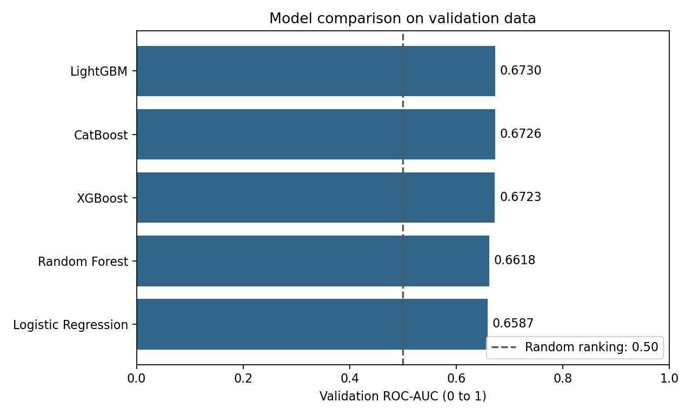
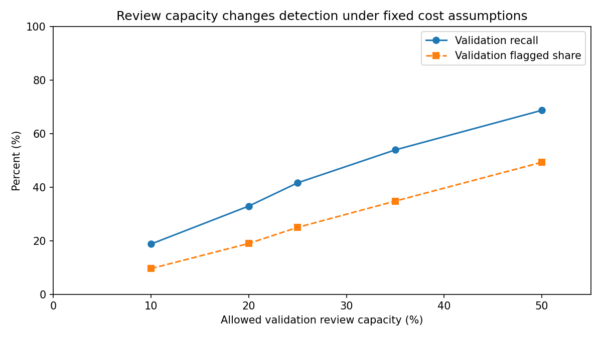
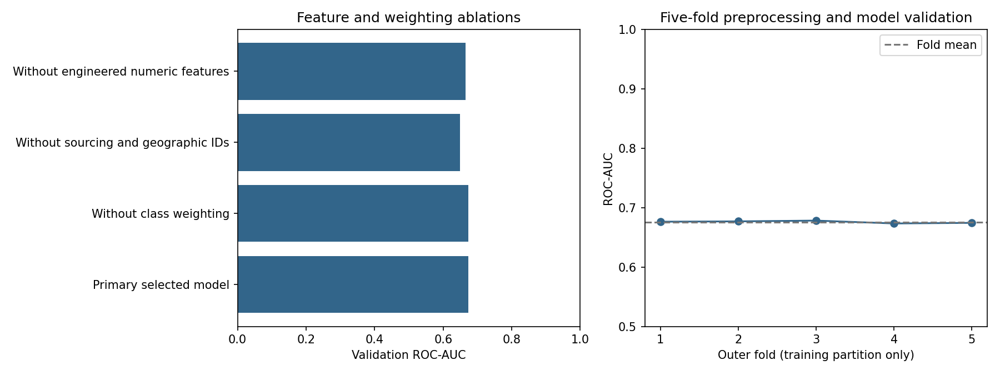
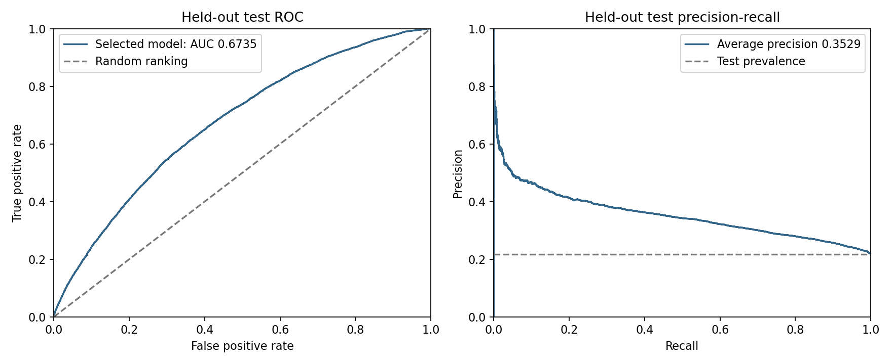
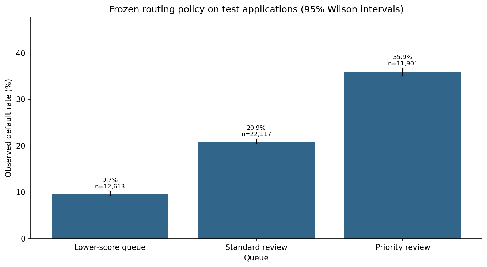

# Vehicle Loan Default Prediction

## Credit risk analysis: from application data to review priorities

This study analyzes **233,154 vehicle-loan applications** to answer a practical question: **which applications should receive closer review when a credit team can inspect only about one quarter of its workload?** It connects exploratory data analysis, controlled model experiments, and review-capacity scenarios to business decisions.

The selected LightGBM model achieved a held-out **ROC-AUC of 0.6735**. A cutoff chosen on validation data captured **42.2% of defaults** while flagging **25.5% of test applications**. The result supports risk prioritization, while the missed defaults and false positives show why a score alone is insufficient for a lending decision.

Three findings shape the business interpretation:

- **Loan structure and bureau information belong together.** Training default rates were 25.82% above 80% LTV versus 19.48% at or below 80%; bureau-score groups further separated risk within similar LTV ranges.
- **Historical sourcing context contributes to the model.** Removing sourcing and geographic identifiers reduced validation AUC from 0.6730 to 0.6494, creating a need to test performance on new entities and periods.
- **Review capacity is a business choice with measurable consequences.** Increasing the validation review cap improved default recall while lowering precision. Staffing remains part of the risk trade-off.

[Executed notebook](vehicle-loan-default-prediction/notebooks/vehicle_loan_default_prediction.ipynb) · [Python analysis](vehicle-loan-default-prediction/src/credit_risk.py) · [Methodology](vehicle-loan-default-prediction/METHODOLOGY.md) · [Evidence index](vehicle-loan-default-prediction/reports/README.md)

## 1. Problem Identification

Vehicle-loan underwriting must balance missed defaults, unnecessary scrutiny of viable applicants, and limited reviewer time. A **false negative** is a defaulting application below the review cutoff. A **false positive** is a non-defaulting application flagged for review. Their different business costs mean that maximizing classification accuracy would not answer the operational question.

The target is the provider-supplied binary `LOAN_DEFAULT` outcome. There are **50,611 defaults (21.71%)** in the labeled data. Predicting every test application as non-default would achieve **78.29% accuracy** while detecting no defaults. That baseline motivates a ranking model evaluated with ROC-AUC and average precision, followed by recall, precision, and workload at a chosen cutoff.

ROC-AUC measures discrimination across thresholds. Average precision summarizes the precision-recall relationship and helps interpret ranking when defaults are the minority outcome. For a credit team, those measures become useful when translated into cases reviewed, defaults captured, and non-defaults flagged.

The objectives are to identify meaningful risk patterns, compare models under consistent conditions, and estimate the implications of a capacity-constrained review policy. This offline case study does not demonstrate realized loss prevention.

## 2. Sourcing of Raw Data

The local data originates from the Kaggle mirror of the LTFS Data Science FinHack dataset. It contains loan and asset amounts, LTV, employment, bureau scores, account activity and delinquency, sourcing identifiers, demographic dates, and document indicators. Training disbursals cover **August-October 2018**, making this a historical benchmark rather than evidence about current applicant behavior.

| Partition | Applications | Purpose |
| --- | ---: | --- |
| Training | 139,892 | EDA, preprocessing, model fitting, and internal cross-validation |
| Validation | 46,631 | Primary model choice, policy cutoffs, and diagnostic experiments |
| Held-out test | 46,631 | Evaluation of the frozen primary model and policy |

The labeled data is split **60/20/20**, stratified by outcome with seed 42, before fitting preprocessing. The source `test.csv` is unlabeled; reported test results come from labeled `train.csv`. Application IDs are checked for uniqueness and excluded from modeling. The target is retained as supplied, without inferring lifetime default or a measured loss amount.

Raw files remain local and are excluded from Git. Published evidence contains aggregates, charts, and model-level metrics. [Data](vehicle-loan-default-prediction/data/README.md) describes acquisition and field coverage.

## 3. Data Preprocessing & Preparation

### 3.1 Data quality: establish what the model can learn reliably

Data-quality analysis comes first because missingness, parsing errors, and extreme values can masquerade as risk signals. There were no duplicate training application IDs or full rows, and no missing or implausible engineered ages under the implemented 18-100-year check. Employment was missing for **4,636 training applications (3.31%)** and remains an explicit `Unknown` category. Numerical missing values use training medians.

`MOBILENO_AVL_FLAG` is constant in training and cannot distinguish outcomes there. It remains in the benchmark, but should not be interpreted as useful predictive evidence. Some account balances are negative and financial distributions have long tails; their field meanings deserve confirmation rather than automatic treatment as errors.

The median disbursed amount was **53,803**, the 99th percentile **95,490**, and the maximum **987,354**, in dataset amount units. This spread explains why quantiles and distributions are examined alongside averages. Histograms clip displayed values at p99 and use logarithmic count axes; this display operation does not clip model inputs.



The business implication is to validate unusual amounts and balance semantics in the input pipeline. A large amount alone is not evidence of a bad application. See the [quality table](vehicle-loan-default-prediction/reports/tables/data_quality.csv) and [financial summary](vehicle-loan-default-prediction/reports/tables/financial_summary.csv).

### 3.2 LTV and loan size: examine the financed purchase

LTV was selected because it describes how much of an asset is financed. Loan amount was examined alongside it because similar LTV can accompany different nominal exposures. Comparing both separates the structure of a loan from its size.

Training default was **25.82% above 80% LTV**, compared with **19.48% at or below 80%**, a **6.34 percentage-point** difference. Loan-size quintiles also show increasing observed default rates in the [loan-amount table](vehicle-loan-default-prediction/reports/tables/loan_amount_default_rates.csv). The highest LTV band has relatively few cases, so every band should not be described as a precise monotonic trend.



Loan structure is useful review context. These associations support investigating affordability and exposure together; they do not establish that a prescribed down payment or LTV cap would cause a particular risk reduction. Changes to terms need evidence beyond this observational dataset.

### 3.3 Bureau scores: distinguish limited credit context from stronger evidence

Bureau information summarizes credit behavior that loan amount alone cannot explain. A score of zero is analyzed separately rather than treated as an ordinary point on a continuous scale. Provider descriptions remain important when interpreting unavailable scores.

The zero-score group accounts for **50.27% of training applications**, with **23.25% default**, compared with **20.15%** for scores above zero. Among displayed bureau descriptions, `M-Very High Risk` has a **30.04%** default rate and `B-Very Low Risk` **13.09%**. All groups remain in CSV; groups below 500 applications are omitted from this chart to limit sparse comparisons.



The business opportunity is to test whether additional repayment-capacity information improves assessment for applicants with limited bureau evidence. This population is too large to treat as an exceptional case, and its observed rate does not justify automatic rejection. The [score-presence table](vehicle-loan-default-prediction/reports/tables/bureau_score_presence.csv) retains the group evidence.

### 3.4 Inquiries and delinquency: warning signals with limited coverage

Inquiries and recent delinquent accounts were selected to explore borrowing activity and repayment stress. Counts of three or more are grouped to reduce dependence on sparse individual values.

| Inquiries | Training applications | Default rate | Share of applications |
| --- | --- | --- | --- |
| 0 | 121,135 | 21.07% | 86.59% |
| 1 | 13,472 | 24.42% | 9.63% |
| 2 | 3,218 | 27.35% | 2.30% |
| 3+ | 2,067 | 32.32% | 1.48% |

Default rises from **21.07% with no inquiries** to **32.32% with three or more**. However, the high-inquiry group represents only **1.48% of applications** and contains **2.2% of training defaults**. A rule targeting that group alone would have limited coverage despite its elevated rate.



For recent delinquency, default is **21.24% with no delinquent accounts** versus **27.11% with one**. Yet **90.3% of training defaults occur in the no-recent-delinquency group**, reflecting its much larger size. These patterns explain why multivariable ranking is worth testing: warning flags can identify risk pockets while still missing most defaults individually. See the [delinquency evidence](vehicle-loan-default-prediction/reports/tables/delinquency_default_rates.csv).

### 3.5 Employment, age, and calendar: describe differences without making rules

Employment was explored for differences in repayment context. Self-employed applications have **22.72% training default**, versus **20.37%** for salaried applications, a **2.35 percentage-point** gap. That difference is smaller than several bureau and loan-structure comparisons and does not establish an independent effect of employment type.

The 18-25 age band has **24.41% default**, versus **17.99%** in the 55-100 band. These are population descriptions, not eligibility criteria. Age, geography, and document-related features require subgroup and fairness evaluation before operational use.

Calendar analysis examines consistency across the short historical window. Default changes from **19.12% in September** to **23.56% in October**. Applicant mix, sourcing, seasonality, or other causes are not separated by this analysis. The difference motivates future-period validation before relying on a random-split benchmark.

Supporting charts: [employment](vehicle-loan-default-prediction/reports/figures/employment_default_rates.png), [age](vehicle-loan-default-prediction/reports/figures/age_default_rates.png), and [month](vehicle-loan-default-prediction/reports/figures/monthly_default_rates.png).

### 3.6 Sourcing and joint patterns: examine where prediction may transfer poorly

Sourcing was examined because dealers, branches, staff, and areas may represent different applicant populations. **28.93% of training applications belong to postcode groups with fewer than 30 training cases.** Sparse groups motivate smoothing and unseen-category handling, while weakening confidence that historical entity rates will transfer unchanged.

Correlations describe linear associations rather than proving which model family should win. The joint LTV/bureau analysis adds context: default is **12.07% for LTV at or below 70% with score 650+**, versus **28.84% above 80% LTV with scores 1-649**. Even within LTV above 80%, the score-650+ group's rate is **19.39%**. One loan term does not describe the whole risk profile.



This supports evaluating multiple signals together and testing transfer to new sourcing populations. It does not establish causal interactions or an individual decision rule. See the [concentration table](vehicle-loan-default-prediction/reports/tables/entity_concentration.csv), [correlation matrix](vehicle-loan-default-prediction/reports/figures/correlation_matrix.png), and [joint-rate table](vehicle-loan-default-prediction/reports/tables/ltv_bureau_interaction.csv).

EDA rate comparisons include counts and pointwise 95% Wilson intervals. These describe binomial sampling uncertainty without adjustments for multiple comparisons, entity dependence, or unmeasured confounding. The complete [15-chart inventory](vehicle-loan-default-prediction/reports/eda_summary.json) is available with the notebook.

### 3.7 Translate exploration into features and evaluation boundaries

Dates become age and calendar features, duration strings become months, and loan/account amounts produce down-payment, utilization, and overdue-account ratios. Application IDs and raw date/duration strings are excluded after transformation. Features are computed per application without other rows or their labels.

High-cardinality categories use smoothed target encoding with five internal cross-fitting folds in training. Validation and test use training-only mappings, with unseen categories falling back to the training prior. Numerical medians and the logistic-regression scaler are also fitted on training only. Outer performance cross-validation rebuilds all preprocessing inside each outer training fold. These boundaries keep evaluation outcomes out of fitted transformations.

## 4. AI/ML Algorithm Identification

Five families test whether additional flexibility improves ranking over a linear baseline under consistent conditions.

| Model | Why included | Comparison question |
| --- | --- | --- |
| Logistic Regression | Simpler linear baseline | Do complex models add ranking value? |
| Random Forest | Bagged nonlinear model | Do tree interactions improve on the baseline? |
| XGBoost | Regularized gradient boosting | Does sequential boosting improve ranking? |
| LightGBM | Efficient boosted-tree implementation | Is this configuration a competitive primary model? |
| CatBoost | Another boosting implementation | Does a different tree-building approach change the result? |

All five use the same encoded matrix and training population, with class weighting. CatBoost uses that common representation rather than a separately optimized native-categorical pipeline. Settings are explicit in [Python](vehicle-loan-default-prediction/src/credit_risk.py); no exhaustive search or universally best algorithm is claimed.

## 5. Training & Testing the Model

The primary benchmark changes the estimator while fixing the split, features, and selection metric, making differences easier to interpret than results from unrelated experiments.

| Model | Validation ROC-AUC | Validation AP | Fit seconds (reference run) |
| --- | --- | --- | --- |
| LightGBM | 0.6730 | 0.3555 | 11.5 |
| CatBoost | 0.6726 | 0.3559 | 39.3 |
| XGBoost | 0.6723 | 0.3555 | 10.1 |
| Random Forest | 0.6618 | 0.3410 | 27.1 |
| Logistic Regression | 0.6587 | 0.3388 | 0.7 |



LightGBM leads on validation ROC-AUC at **0.6730**, versus **0.6587** for logistic regression, a difference of **+0.0142**. The three boosted models are close. CatBoost has slightly higher validation average precision than LightGBM; selection follows the declared ROC-AUC criterion rather than superiority on every metric. Fit times describe the reference run, not general hardware performance.

### Controlled experiments: identify what contributes

The selected family is challenged by removing information or changing part of its configuration. A fixed blend uses XGBoost/LightGBM/CatBoost weights of 0.35/0.35/0.30. Every comparison below uses validation outcomes; diagnostic challengers do not silently replace the primary model through test inspection.

| Experiment | Validation ROC-AUC | Validation AP | AUC change vs primary |
| --- | --- | --- | --- |
| Primary selected model | 0.6730 | 0.3555 | +0.00000 |
| Without class weighting | 0.6731 | 0.3567 | +0.00011 |
| Without sourcing and geographic IDs | 0.6494 | 0.3295 | -0.02357 |
| Without engineered numeric features | 0.6653 | 0.3451 | -0.00768 |
| Smaller trees (15 leaves) | 0.6723 | 0.3544 | -0.00063 |
| Stronger regularization | 0.6730 | 0.3557 | +0.00003 |
| Fixed blend: XGB 0.35 / LGBM 0.35 / Cat 0.30 | 0.6733 | 0.3565 | +0.00034 |

Four conclusions follow:

1. **Sourcing context contributes ranking information within this split.** Removing six sourcing/geographic IDs lowers AUC to **0.6494** (change **-0.0236**). Shared entities across random partitions can make transfer look easier than deployment to new entities.
2. **Derived features add information under this configuration.** Removing engineered numeric features lowers AUC to **0.6653** (change **-0.0077**). This supports retaining and validating those transformations without claiming every feature is necessary.
3. **Weighting is not established as a ranking improvement.** Disabling weights changes AUC by **+0.00011**. Weighting changes score scale and error trade-offs; its use does not demonstrate improved AUC or calibrated probabilities.
4. **Extra complexity adds little observed ranking gain here.** The fixed blend reaches **0.6733**, a change of **+0.00034**. Parameter challengers are also close. No significance test establishes persistence of those small gains in new populations.

The practical insight is to prioritize data quality, transfer evaluation, and operational measurement before assuming that more tuning or an ensemble will materially improve business outcomes. [Experiment tables](vehicle-loan-default-prediction/reports/README.md) preserve the results.

## 6. Choosing the Appropriate Model

Primary selection uses validation ROC-AUC. The review cutoff is chosen separately by minimizing assumed error cost while flagging at most 25% of validation applications. A grid from 0 to 1 in steps of 0.005, plus a no-review endpoint, produces a cutoff of **0.585** and validation flagged share of **24.97%**.

A ranking model can remain unchanged while costs or capacity change its operating point. The 25% cap is a scenario assumption, not a measured staffing limit of a particular lender.

### Capacity changes what the model can deliver

Five review caps, three assumed loss rates, and three lost-margin rates produce **45 validation-only scenarios**. The table holds 45% loss and 8% lost margin fixed to isolate capacity.

| Validation review cap | Cutoff | Actually flagged | Default recall | Precision | Assumed cost reduction |
| --- | --- | --- | --- | --- | --- |
| 10% | 0.670 | 9.6% | 18.8% | 42.5% | 14.2% |
| 20% | 0.615 | 19.0% | 32.9% | 37.7% | 23.2% |
| 25% | 0.585 | 25.0% | 41.6% | 36.2% | 28.6% |
| 35% | 0.540 | 34.8% | 53.9% | 33.6% | 35.0% |
| 50% | 0.475 | 49.3% | 68.7% | 30.3% | 40.6% |



More capacity captures more defaults, but added cases have lower precision. Staffing is therefore part of business value. A pilot should measure how many additional defaults are identified per additional case reviewed and reviewer hour, and at what real cost.

## 7. Validation

### Generalization, seed stability, and uncertainty

Five-fold performance validation within training refits imputation, encoding, and the estimator in every outer fold. Mean AUC is **0.6758**, with fold sample SD **0.0019**. Four estimator seeds give a validation AUC range of **0.0002** on a fixed split and encoding. These checks show limited variation under those conditions, not robustness to future periods or unseen entities.

In-sample training AUC is **0.7204**, versus **0.6730** on validation, a gap of **0.0475**. That fitting optimism deserves investigation rather than being declared acceptable without an operational standard. Test AUC is **0.6735**, with a pointwise 95% bootstrap interval of **0.6676-0.6793**. The 200 stratified row-bootstrap samples condition on the frozen model and observed prevalence, excluding fitting uncertainty and entity dependence.



### Frozen test policy: translate scores into counts

| Test measure | Result |
| --- | ---: |
| Applications | 46,631 |
| ROC-AUC / average precision | 0.6735 / 0.3529 |
| Frozen cutoff | 0.585 |
| Default recall | 42.2% |
| Precision among flagged applications | 35.9% |
| Applications flagged | 25.52% |
| Defaults flagged / missed | 4,269 / 5,853 |
| Non-defaults flagged / below cutoff | 7,632 / 28,877 |



The queue has approximately **1.65 times the overall test default rate**, concentrating risk into fewer cases. However, **57.8% of defaults remain below the cutoff**, and **64.1% of flagged applications do not default**. The model is a prioritization aid with material coverage and false-positive limits, not an automatic rejection mechanism.

The unchanged cutoff flags **25.52% on test**, versus **24.97% on validation**. A validation cap does not guarantee future workload. Operations must measure capacity shortfalls and define escalation without silently retuning on new outcome labels.

Native importance ranks `BRANCH_ID`, `CURRENT_PINCODE_ID`, `EMPLOYEE_CODE_ID`, `AGE_AT_DISBURSAL`, `SUPPLIER_ID` among the leading inputs. For this fitted LightGBM configuration the recorded importance is split-based, not a causal effect, contribution to profit, or individual explanation. Group ablation is a more direct test of sourcing information under the chosen design.

## 8. Model Deployment

### Offline routing into review queues

The executable demonstration applies a validation-fitted lower cutoff of **0.360** and high cutoff **0.585**. The lower cutoff is the largest eligible cutoff with at least 5% of validation applications, at least 30 cases, and observed default at most 10% below it. That fitted condition is not a guarantee on new data.

| Test queue | Applications | Share | Observed default rate | 95% Wilson interval |
| --- | --- | --- | --- | --- |
| Lower-score queue | 12,613 | 27.0% | 9.71% | 9.21% - 10.24% |
| Standard review | 22,117 | 47.4% | 20.93% | 20.39% - 21.47% |
| Priority review | 11,901 | 25.5% | 35.87% | 35.01% - 36.74% |



The priority queue's observed rate is **3.69 times** the lower-score queue's rate. That can help organize human assessment. The lower-score queue still contains **1,225 defaults**, at a rate of **9.71%**, so it does not establish unrestricted automatic approval. All queues retain normal underwriting; no automatic lending action is implemented.

The proposed flow is `application -> input checks -> training-fitted preprocessing -> score -> frozen queue rules -> human assessment -> recorded outcome`. APIs, authentication, a model registry, service levels, and lending-system integration remain proposed work.

### Financial interpretation: a conditional scenario

The scenario uses an average training loan of **54,375.81** amount units, assigning **24,469.12** per missed default (45%) and **4,350.06** per flagged non-default (8%). Cost is `FN * cost_FN + FP * cost_FP`.

The frozen high cutoff gives assumed test error cost **176,417,428**, versus **247,676,386** for approving all, an assumed reduction of **28.8%**. The predeclared 0.50 cutoff gives **63.9% recall** and a **39.0%** assumed reduction, but flags **44.3%** of applications, beyond the intended review share.

The lowest simulated cost is therefore not automatically operationally feasible. Strong assumptions also apply: every flagged default loss is treated as preventable, flagged non-defaults incur lost margin, and actual review costs, recoveries, and intervention effects are absent. Review does not itself prevent default. These are illustrative dataset amount units, not realized savings or a verified return.

## 9. Model Monitoring, Feedback & Continuous Improvement

Offline monitoring compares training-reference distributions with validation using quantile-reference PSI bins, an explicit missing-value bin, and unseen-category rates. For example, **0.63% of validation applications have a postcode category unseen in training**, handled through the training-prior fallback. Low PSI in a random split does not establish stability of a live population.

| Monitoring area | Business question | Proposed response |
| --- | --- | --- |
| Schema, missingness, unusual values | Are inputs comparable and interpretable? | Investigate upstream changes and isolate malformed inputs |
| New entities and population shifts | Are sourcing patterns changing? | Review fallback behavior and transfer performance |
| Queue volume and workload | Can reviewers process flagged cases? | Escalate constraints and measure productivity |
| Mature-label ranking and calibration | Does separation persist after outcomes arrive? | Compare with a frozen reference and investigate deterioration |
| Subgroup outcomes and overrides | Are errors concentrated in particular populations? | Audit proxies, overrides, and decision evidence |
| Costs and intervention results | Does review improve business outcomes? | Replace assumptions with observed pilot measurements |

No universal PSI alert threshold, live scheduler, or production feedback integration is claimed. The [monitoring plan](vehicle-loan-default-prediction/reports/tables/monitoring_plan.csv) is a proposed process supported by offline calculations. A challenger needs a new future-period holdout and versioned evaluation before replacing the primary model.

## 10. Business Recommendations

| Evidence | Business insight | Next action | Pilot measure |
| --- | --- | --- | --- |
| 42.2% recall at 25.5% flagged share | Risk concentrates, but many defaults remain outside the queue | Pilot prioritized human review with normal underwriting retained | Defaults per reviewed case and reviewer hour; missed-default share |
| LTV and bureau groups jointly separate risk | Loan structure needs credit and affordability context | Test verified repayment-capacity information before changing terms | Prospective ranking and review outcomes |
| 50.27% of training cases have zero bureau scores | Limited bureau context affects a large population | Evaluate additional information without automatic exclusion | Subgroup recall, precision, calibration, and outcomes |
| Removing sourcing IDs lowers AUC to 0.6494 | Historical sourcing patterns contribute to performance | Test unseen-entity and future-period transfer; examine proxies | AUC/AP and errors by period and entity cohort |
| Ensemble and parameter gains are small | Added complexity has no established material business benefit here | Keep challengers reproducible and prioritize stronger evaluation data | New-holdout gain relative to operating complexity |
| 28.8% cost reduction depends on assumptions | This benchmark has not measured a business return | Collect review costs, recoveries, margins, and intervention effects | Observed net cost and capacity-adjusted outcomes |

The supported conclusion is that available application data offers **moderate risk ranking** that can inform review priorities. EDA explains why individual warning signals have limited coverage. Controlled experiments show value from derived features alongside dependence on sourcing context. Capacity scenarios connect those statistical findings to staffing and risk choices.

The dataset was explored before this revision, random partitions can share entities, and validation supports both model and policy design. No future-period holdout, external validation, calibrated probability model, measured intervention effect, or production integration has been established. These boundaries define the next evidence needed before turning this case study into lending policy.

## Reproduce and inspect the report

The [notebook](vehicle-loan-default-prediction/notebooks/vehicle_loan_default_prediction.ipynb) contains all ten stages. Shared modules separate [modeling](vehicle-loan-default-prediction/src/credit_risk.py), [EDA](vehicle-loan-default-prediction/src/eda.py), [experiments](vehicle-loan-default-prediction/src/experiments.py), and [offline operations](vehicle-loan-default-prediction/src/operations.py). [Metrics](vehicle-loan-default-prediction/reports/metrics.json), [experiment summaries](vehicle-loan-default-prediction/reports/experiments.json), and [aggregate tables](vehicle-loan-default-prediction/reports/README.md) provide the evidence.

From this workspace root, enter the analysis folder first. Use Python 3.11 and local `vehicle-loan-default-prediction/data/raw/train.csv`:

```powershell
cd .\vehicle-loan-default-prediction
python -m venv .venv
.\.venv\Scripts\Activate.ps1
python -m pip install -r requirements.txt
python -m unittest discover -s tests -v
python scripts/build_notebook.py --execute
python scripts/update_readme.py
python scripts/verify_portfolio.py
```

For the same analytical run through the CLI, use `python src/credit_risk.py --data data/raw/train.csv --output reports`, then refresh this README. The recommendations CSV is produced by the notebook. Sample runs use `--sample 5000 --output reports/smoke` to preserve published full-data evidence.

The README is rendered from JSON/CSV results and a versioned [report template](vehicle-loan-default-prediction/scripts/templates/README.md.in), preserving the narrative when its numbers are refreshed. The reference environment used Python **3.11.14**; exact versions are in `requirements.txt` and `metrics.json`. A fresh-environment installation has not been independently verified.

Attribution: [LTFS / Analytics Vidhya](https://www.analyticsvidhya.com/datahack/contest/ltfs-datascience-finhack-an-online-hackathon/) and the [Kaggle mirror](https://www.kaggle.com/datasets/avikpaul4u/vehicle-loan-default-prediction). Raw data is not redistributed; see [Data](vehicle-loan-default-prediction/data/README.md). Method references are linked in the notebook and [Methodology](vehicle-loan-default-prediction/METHODOLOGY.md).
# vehicle-loan-risk-analytics
